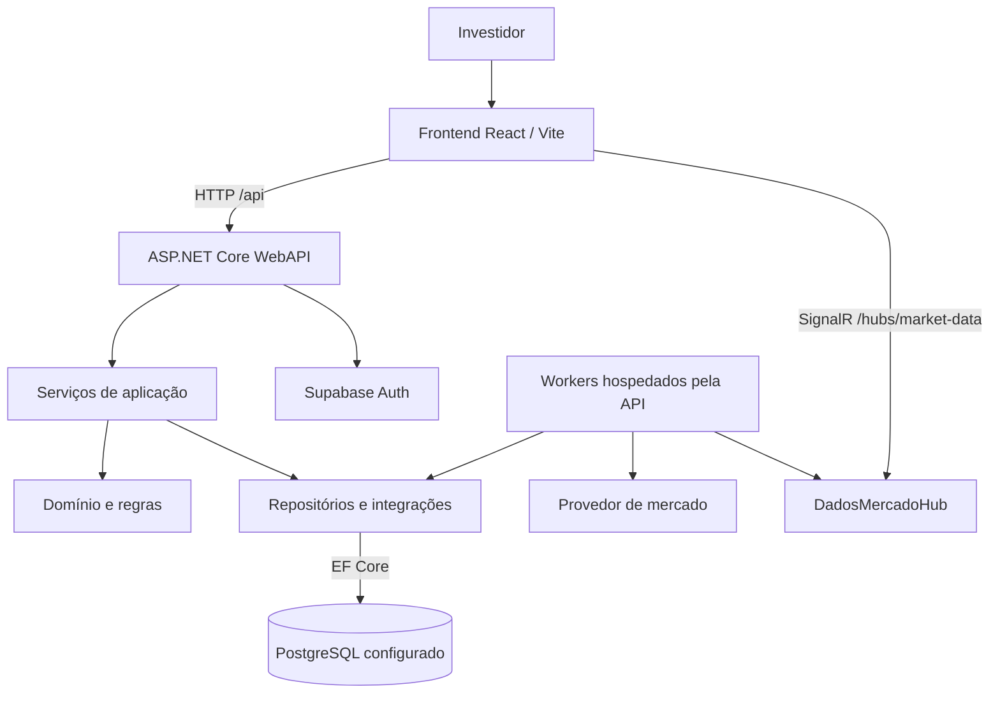

# Arquitetura do sistema

Revisão estática em 13/11/2026, no checkout `f85ae79` com alterações locais. O diagrama representa componentes encontrados no código e na configuração Compose; não comprova conectividade ou operação em produção.

O [Compose](../../docker-compose.yml) usa um container PostgreSQL local baseado na imagem Supabase; a conexão EF Core vem da configuração e não implica banco Supabase gerenciado. O provedor Supabase autentica a identidade; a aplicação emite e valida seus próprios JWTs. A API registra os workers de mercado e vencimento fora do ambiente `Testing` ([Program.cs](../../src/InvestDashboard.WebAPI/Program.cs)).

## Registro de operação

`POST /api/v1/transactions` recebe [`RegistrarTransacaoDto`](../../src/InvestDashboard.Application/DTOs/Trading/RegistrarTransacaoDto.cs). O [controller](../../src/InvestDashboard.WebAPI/Controllers/TransacoesController.cs) autorizado chama o serviço de aplicação; o domínio processa a operação e a infraestrutura persiste as alterações. Em sucesso, o controller retorna `201 Created` com envelope e localização da lista de transações da carteira. A autorização e o tratamento de falhas dependem do fluxo concreto de aplicação e middleware.

## Atualização de preços

O [worker de mercado](../../src/InvestDashboard.Infrastructure/BackgroundWorkers/AtualizadorDadosMercadoWorker.cs) consulta o provedor para ativos que não são de renda fixa, persiste observações válidas e publica `OnPriceUpdate` para grupos por ticker. O [hook do frontend](../../frontend/src/hooks/useSignalR.ts) conecta ao hub quando autenticado, assina tickers e atualiza o store de mercado. O intervalo configurável tem padrão de 60 segundos e limites de 30 a 3600 segundos; falhas de consulta preservam o último preço armazenado. Esses caminhos não demonstram entrega instantânea ou disponibilidade sustentada.
