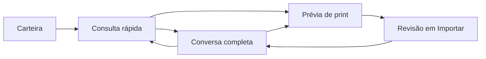

# Auditoria e handoff de UX

- Subplano: [UX-01](../01-descoberta-ux.md)
- Estado: experiência híbrida selecionada pelo usuário em 27/11/2026. Handoff e validação do protótipo em andamento.
- Referência: dashboard InvestPro, navegação lateral, tema escuro, componentes React/shadcn e tokens atuais.

## Tarefas para comparar nas três propostas

Selecionar uma carteira sintética, consultar saldo observado de Tesouro, conferir qual provedor atendeu e abrir uma prévia de print para revisão na importação. Na revisão, separar data do saldo, período de rentabilidade e natureza do valor. Diferenciar saldo observado, marcação a mercado e projeção com rótulo, fonte e data.

## Matriz de estados

| Fluxo | Estados e comportamento esperado |
|---|---|
| Configuração | Chave ausente ou configurada sem revelar valor, teste em andamento, sucesso, modelo incompatível, provedor fora, conflito na gravação. |
| Chat | Escolha de carteira ou grupo, vazio, envio, streaming, interrupção, erro parcial, histórico e escopo revogado. Preservar foco e anunciar estado sem reler cada token. |
| Provedor | Local ou nuvem elegível, fallback com identificação do provedor efetivo, nenhum disponível, cota esgotada. |
| Print | Anexo escolhido, processamento, prévia editável, leitura incompleta, saldo indefinido, conflito ou prévia expirada. Registrar saldo bruto somente com revisão e confirmação. |
| Renda fixa | Dados suficientes, premissas ausentes, alerta contextual explicado, valores observados e projetados com datas distintas. |

## Handoff após escolha

Detalhar desktop e celular, teclado, foco, semântica da tabela e estados sem cor como único indicador. Conferir reflow a 320 px e navegação a 767/768 px quando afetada. Entregar wireframes e protótipo no subplano UX-01 e referenciar [IA-02](../03-politica-provedores.md), [TD-02](../05-revisao-saldo.md), [AS-03](../08-interface-assistente.md), [AS-04](../09-assistente-grupos.md), [AS-05](../10-anexos-assistente.md), [RF-01](../11-classificacao-alertas.md) e [RF-02](../12-projecoes-renda-fixa.md).

## Alternativas e decisão

1. [Página dedicada](propostas/01-pagina-dedicada.png). Dá mais espaço ao histórico. Exige sair do detalhe para consultar a carteira.
2. [Painel na carteira](propostas/02-painel-na-carteira.png). Mantém o contexto e torna rápida a consulta. O painel disputa espaço com posições em larguras intermediárias.
3. [Experiência híbrida](propostas/03-experiencia-hibrida.png). Combina consulta rápida e página completa. Exige preservar contexto e turno na passagem entre superfícies.

A opção 3 foi escolhida pelo usuário. Os mockups são referências de composição. No fluxo aprovado, o provedor efetivo é informativo, os formatos são PNG, JPEG e WebP, a prévia pendente pede revisão e a confirmação financeira só existe no fluxo de importação. Histórico não deve inventar números nem exibir Markdown sem renderização.

## Wireframes e especificação responsiva

| Faixa | Carteira e consulta rápida | Conversa completa | Revisão |
|---|---|---|---|
| Desktop | Cabeçalho com escopo e ação para conversa completa. Tabela ocupa a coluna principal. Painel lateral inline com provedor, mensagens, prévia e composer. Rolagem de tabela isolada. | Histórico em coluna e conteúdo na área principal. Manter carteira e provedor visíveis no cabeçalho. | Tela separada com resumo de origem, campos e data, voltar à conversa e ação de confirmação apenas no produto real. |
| Celular | Empilhar carteira e consulta rápida. A ação de abrir conversa completa ocupa largura disponível. Sem rolagem horizontal na página. | Histórico como região expansível. Composer e botão de interromper acessíveis pelo teclado e sem sobreposição com o conteúdo. | Campos em sequência, rótulos e mensagens sem depender de cor. Ações de voltar e revisar com alvo de toque. |

A passagem rápida/completa preserva carteira, ID da conversa e turno. Usar botão semântico para interromper, restaurar foco à ação de origem ao voltar, anunciar status por região viva sem anunciar cada fragmento e não mover a leitura enquanto a pessoa estiver consultando mensagens anteriores. Rótulos de origem sugeridos são “Ollama · Local” e “OpenRouter · Nuvem”. Texto de prévia sugerido é “Aguardando revisão no Tesouro”.
