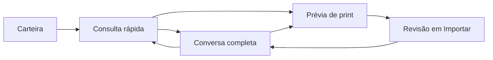

# Auditoria e handoff de UX

- Subplano: [UX-01](../01-descoberta-ux.md)
- Estado: experiência híbrida selecionada pelo usuário em 27/11/2026. Handoff e protótipo verificados localmente.
- Referência: dashboard InvestPro, navegação lateral, tema escuro, componentes React/shadcn e tokens atuais.

## Tarefas para comparar nas três propostas

Selecionar uma carteira sintética, consultar saldo observado de Tesouro, conferir qual provedor atendeu e abrir uma prévia de print para revisão na importação. Na revisão, separar data do saldo, período de rentabilidade e natureza do valor. Diferenciar saldo observado, marcação a mercado e projeção com rótulo, fonte e data.

## Matriz de estados

| Fluxo | Estados e comportamento esperado |
|---|---|
| Configuração | Chave ausente ou configurada sem revelar valor, teste em andamento, sucesso, modelo incompatível, provedor fora, conflito na gravação. |
| Chat | Escolha de carteira ou grupo, vazio, envio, streaming, interrupção, erro parcial, histórico e escopo revogado. Preservar foco e anunciar estado sem reler cada token. |
| Provedor | Local ou nuvem elegível, fallback com identificação do provedor efetivo, nenhum disponível, cota esgotada. |
| Print | Anexo escolhido, processamento, prévia editável, leitura incompleta, saldo indefinido, conflito ou prévia expirada. Registrar saldo bruto somente com revisão e confirmação. |
| Renda fixa | Dados suficientes, premissas ausentes, alerta contextual explicado, valores observados e projetados com datas distintas. |

## Handoff após escolha

Detalhar desktop e celular, teclado, foco, semântica da tabela e estados sem cor como único indicador. Conferir reflow a 320 px e navegação a 767/768 px quando afetada. Entregar wireframes e protótipo no subplano UX-01 e referenciar [IA-02](../03-politica-provedores.md), [TD-02](../05-revisao-saldo.md), [AS-03](../08-interface-assistente.md), [AS-04](../09-assistente-grupos.md), [AS-05](../10-anexos-assistente.md), [RF-01](../11-classificacao-alertas.md) e [RF-02](../12-projecoes-renda-fixa.md).

## Auditoria do produto atual

Auditei o Invest Dashboard em execução local no Vite (`127.0.0.1:5184`), com `VITE_USE_MSW=true`, sessão de teste e dados sintéticos. A extração de renda fixa consolidada usou uma resposta de demonstração injetada somente no navegador para que a tela pudesse mostrar linhas representativas. Nenhuma conta ou API financeira real foi usada.

A captura Playwright local cobriu dashboard, menu, lista e detalhe de carteira, Configurações, as abas de importação, Renda Fixa, tema claro/escuro e viewports 1366 × 768, 360 × 800 e 320 × 800. O breakpoint do menu foi observado em 767 e 768 px. O MCP Playwright não iniciou após timeout de handoff; a captura foi realizada com o Chromium 1255 local por Playwright, em processo isolado.

Com uma linha sintética carregada na tela de renda fixa, `documentElement.scrollWidth` e `body.scrollWidth` permaneceram iguais ao viewport em 320, 360, 767, 768, 1280, 1366 e 1920 px. Em 768, 1280 e 1366 px, a região da tabela mede 412, 924 e 1010 px, respectivamente, enquanto o conteúdo tabular mede 1327 px. A tabela rola dentro da sua região, e o documento não se alarga.

As respostas 401 registradas ocorreram durante a checagem de sessão anterior ao login simulado. Não houve exceções JavaScript. O smoke não substitui a suite de testes do projeto, e não avaliou leitor de tela, zoom, WebKit, produção nem dados conectados.

## Percurso observado

1. **Entrada e navegação.** O menu de desktop mostra nomes e ícones. Em 767 px vira um painel móvel. Em 768 px a navegação lateral reaparece. As larguras do documento permaneceram contidas nos viewports usados. No handoff, preservar o foco ao fechar o painel. Capturas em [dashboard claro](capturas/01-dashboard-desktop-light.png) e [menu móvel aberto](capturas/16-menu-mobile-aberto-dark.png).
2. **Carteiras e detalhe.** Os cartões de carteiras mostram patrimônio e quantidade de posições. O detalhe abre com indicadores, abas e tabelas para renda fixa e variável. Em celular, os indicadores empilham e as linhas viram cartões. Identificadores longos, como Tesouro IPCA, ficam abreviados na lista e pedem detalhe adicional. Capturas em [carteiras](capturas/02-carteiras-desktop-light.png), [detalhe desktop](capturas/03-carteira-detalhe-desktop-light.png) e [detalhe móvel](capturas/12-carteira-detalhe-mobile-dark.png).
3. **Configurações.** A página contém somente o perfil de conta, com campos somente leitura. Ainda não há controles de provedor. A futura seção de IA deve ser complementar ao perfil e exibir provedor, capacidades, prioridade, status do teste e estado mascarado da chave. Capturas em [claro](capturas/04-configuracoes-desktop-light.png) e [escuro móvel](capturas/13-configuracoes-mobile-dark.png).
4. **Importação.** CSV e Tesouro Direto são fluxos separados em abas. A etapa inicial do Tesouro pede carteira e HTML antes de ativar a análise. Isso já comunica uma prévia por etapas. O controle de arquivo usa a interface nativa do navegador, que apareceu em inglês nas capturas porque o contexto Chromium não recebeu locale `pt-BR`. Capturas em [CSV](capturas/05-importar-operacoes-desktop-light.png), [Tesouro desktop](capturas/06-importar-tesouro-desktop-light.png) e [Tesouro móvel](capturas/14-importar-tesouro-mobile-dark.png).
5. **Renda Fixa.** Grupo, titular, carteira e situação ficam antes da projeção e da tabela. O celular empilha filtros e cartões. O breakpoint muda a tabela para cartões sem alargar o documento. Capturas em [desktop claro](capturas/07-renda-fixa-desktop-light.png), [móvel 320 px](capturas/17-renda-fixa-mobile-320-dark.png) e [cartões em largura estreita](capturas/17b-renda-fixa-tabela-mobile-320-dark.png).

A captura escura da dashboard `01-dashboard-desktop.png` foi preservada como referência preexistente. Os achados usam as capturas desta execução, com sufixos `-light` e `-dark`.

## Achados prioritários

### P1 — Projeção apresenta zero quando o escopo não dispara a consulta

Na rota `/renda-fixa` sem `groupId`, o hook de projeção está desabilitado, enquanto o cartão segue renderizando a ramificação incompleta e usa `projection?.valorObservado ?? 0`. O título do cartão diz “Todos os grupos acessíveis”, e as posições sintéticas estão carregadas, mas o valor observado aparece como R$ 0,00. Isso pode ser interpretado como patrimônio zero. O estado precisa dizer “projeção indisponível para este escopo” ou consultar realmente o consolidado antes de mostrar o número. Evidência visual em [Renda Fixa desktop](capturas/07-renda-fixa-desktop-light.png). Código observado em [FixedIncome.tsx](../../../../frontend/src/pages/investments/FixedIncome.tsx#L91) e [ramificação do cartão](../../../../frontend/src/pages/investments/FixedIncome.tsx#L355).

### P1 — Região da tabela não anuncia nem recebe foco para rolagem horizontal

Em desktop, colunas à direita aparecem truncadas em larguras intermediárias. A tabela mantém o documento no tamanho do viewport e rola dentro do wrapper, mas os usos de `<Table>` não passam `scrollLabel`. O wrapper só recebe `role="region"`, nome e `tabIndex` quando `scrollLabel` está presente. Em 768 px, o viewport da tabela é 412 px para 1327 px de conteúdo. Fornecer nome de região e foco por teclado e indicar visualmente que há colunas à direita. Em celular, a troca para cartões conserva as informações principais, mas títulos e titulares compridos aparecem truncados. Evidência em [carteira](capturas/03-carteira-detalhe-desktop-light.png) e [Renda Fixa móvel](capturas/17b-renda-fixa-tabela-mobile-320-dark.png). Código observado em [table.tsx](../../../../frontend/src/components/ui/table.tsx#L9) e [uso da tabela](../../../../frontend/src/components/investments/FixedIncomeTable.tsx#L443).

### P2 — Filtros usam placeholders como único nome visível

Busca geral e filtro por emissor mostram o propósito no placeholder, que se encurta em 320 px. Nos inputs observados não há `label`, `aria-label` ou `aria-labelledby`. Acrescentar nomes persistentes ou rótulos acessíveis e encurtar o placeholder para caber no layout estreito. Evidência em [320 px](capturas/17b-renda-fixa-tabela-mobile-320-dark.png). Código observado em [FixedIncomeTable.tsx](../../../../frontend/src/components/investments/FixedIncomeTable.tsx#L291).

### P2 — Resultado “líquido” não identifica a base do cálculo

No detalhe da carteira, o indicador “Lucro/Prejuízo” é subtitulado “Resultado líquido”. O cartão não explica no próprio contexto quais taxas, impostos e movimentos compõem “líquido”. O assistente deverá repetir a definição do serviço financeiro e mostrar data e composição disponíveis, sem transformar “líquido” em sinônimo de retorno após impostos por inferência. Captura em [detalhe da carteira](capturas/03-carteira-detalhe-desktop-light.png).

## Alternativas e decisão

1. [Página dedicada](propostas/01-pagina-dedicada.png). Dá mais espaço ao histórico. Exige sair do detalhe para consultar a carteira.
2. [Painel na carteira](propostas/02-painel-na-carteira.png). Mantém o contexto e torna rápida a consulta. O painel disputa espaço com posições em larguras intermediárias.
3. [Experiência híbrida](propostas/03-experiencia-hibrida.png). Combina consulta rápida e página completa. Exige preservar contexto e turno na passagem entre superfícies.

A opção 3 foi escolhida pelo usuário. Os mockups são referências de composição. No fluxo aprovado, o provedor efetivo é informativo, os formatos são PNG, JPEG e WebP, a prévia pendente pede revisão e a confirmação financeira só existe no fluxo de importação. Histórico não deve inventar números nem exibir Markdown sem renderização.

## Wireframes e especificação responsiva

| Faixa | Carteira e consulta rápida | Conversa completa | Revisão |
|---|---|---|---|
| Desktop | Cabeçalho com escopo e ação para conversa completa. Tabela ocupa a coluna principal. Painel lateral inline com provedor, mensagens, prévia e composer. Rolagem de tabela isolada. | Histórico em coluna e conteúdo na área principal. Manter carteira e provedor visíveis no cabeçalho. | Tela separada com resumo de origem, campos e data, voltar à conversa e ação de confirmação apenas no produto real. |
| Celular | Empilhar carteira e consulta rápida. A ação de abrir conversa completa ocupa largura disponível. Sem rolagem horizontal na página. | Histórico como região expansível. Composer e botão de interromper acessíveis pelo teclado e sem sobreposição com o conteúdo. | Campos em sequência, rótulos e mensagens sem depender de cor. Ações de voltar e revisar com alvo de toque. |

A passagem rápida/completa preserva carteira, ID da conversa e turno. Usar botão semântico para interromper, restaurar foco à ação de origem ao voltar, anunciar status por região viva sem anunciar cada fragmento e não mover a leitura enquanto a pessoa estiver consultando mensagens anteriores. Rótulos de origem sugeridos são “Ollama · Local” e “OpenRouter · Nuvem”. Texto de prévia sugerido é “Aguardando revisão no Tesouro”.

## Verificação do protótipo

Rodado em Chromium 148 contra Vite local com dados sintéticos. O build de produção isolado passou. Em 320 × 800, 360 × 800, 1280 × 720, 1366 × 768 e 1920 × 1080, o teste conferiu ausência de rolagem horizontal no documento, consulta rápida, preservação da pergunta ao abrir conversa completa, indicação de provedor e navegação para a revisão e de volta. A revisão visual em 1366 × 768 identificou truncamento monetário nos cartões. Os cartões foram reorganizados para manter os valores legíveis e a tabela larga fica em região própria de rolagem.

Código e instruções em [protótipo](prototipo/README.md). Capturas da [carteira desktop](prototipo/artifacts/hybrid-1366x768-final.png), [conversa móvel](prototipo/artifacts/ux01-360-conversa.png) e [revisão móvel](prototipo/artifacts/ux01-360-revisao.png). A demonstração usa estado local e conteúdo fictício. A autenticação, persistência, cálculo e chamadas a provedores reais são contratos dos subplanos vinculados.
